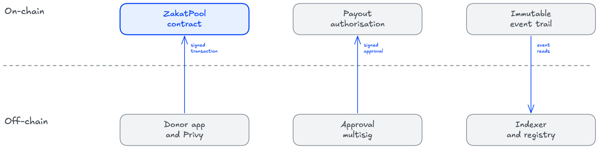
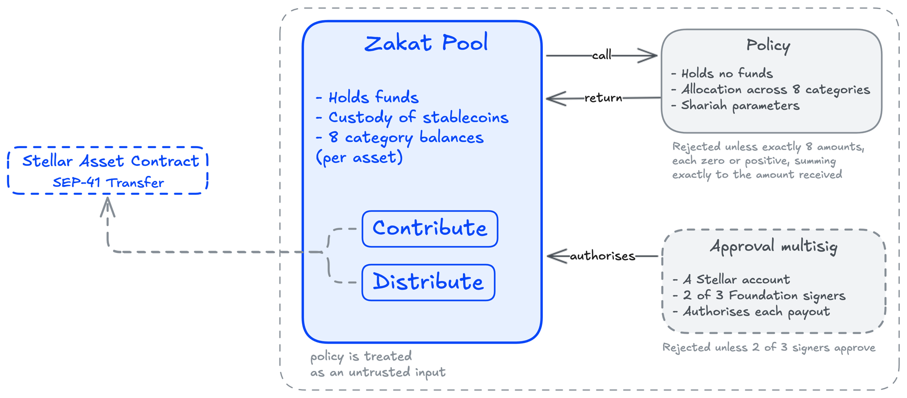
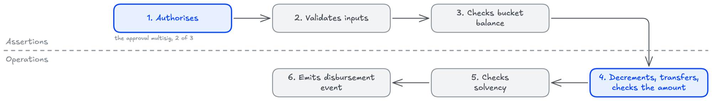
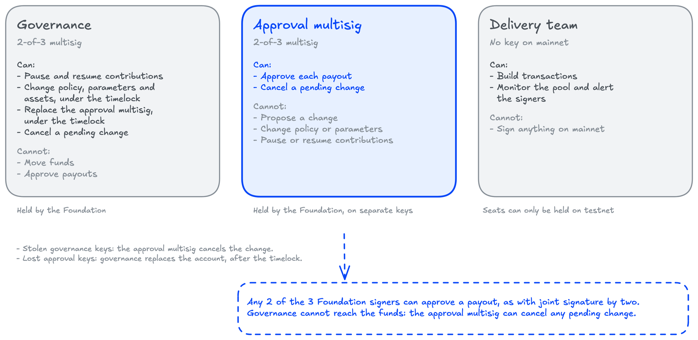

# CipherPhi architecture

CipherPhi moves an operating, audited Swiss zakat foundation onchain. The rules of zakat, pooled custody, allocation across the 8 zakat categories, and distribution only to eligible recipients, are encoded in 2 smart contracts and enforced by 2 Foundation multisigs.

This file is the architecture: what is built, why each decision was settled the way it was, and what is deliberately not being built. Where something a reader might expect is absent, it is named under "Not in this build" with the trigger that would change it.

## The moat

Onchain zakat is not a new idea. HAQQ routes a tenth of every ISLM issuance into the Evergreen DAO endowment for Islamic charity,[^1] Zakat Coin and comparable tokens have proposed donor-facing zakat platforms,[^2] and the academic literature carries several blockchain zakat collection and distribution models.[^3] What almost all of them share is that the chain came first and the institution second: a new token, a new DAO, or a paper design, looking for a zakat body to adopt it.

CipherPhi runs the other way. The Swiss Zakat Foundation already collects and redistributes zakat under federal supervision, with audited accounts and a working eligibility process, and this project puts that existing institution's rail onchain.

The defensible part is not the contract. It is a few thousand lines of Rust that any competent team could write, and this document publishes the design rather than guarding it. The moat is that the collection, the donor base, the vetting process, the partner network, and the audit relationship already exist and are being moved rather than invented. A competitor starting today writes the contract in a month and then spends years becoming a supervised foundation with an unqualified audit opinion.

## Why Stellar

4 pillars, all of them already in the protocol rather than built for this project.

**USDC.** Circle issues USDC on Stellar directly, and CCTP moves it in from other chains by burn and mint rather than through a wrapped asset or a third-party bridge.[^4] A pool holding donated zakat cannot carry bridge counterparty risk, and on Stellar it does not have to.

**Token interface.** Every Stellar asset has a Stellar Asset Contract at a deterministic address implementing SEP-41, so custody and transfer are a standard interface call. There is no token contract in CipherPhi's codebase to write, audit, or get wrong.

**Cheap settlement suited to per-category accounting.** Fees are a fraction of a cent.[^5] Splitting every contribution across 8 zakat categories, with checked arithmetic and an event recording the split, is affordable per contribution, where on a chain with meaningful gas it would push the project toward batching, which is the thing that destroys the audit trail.

**A built-in disbursement rail.** The Stellar Disbursement Platform is maintained by SDF for exactly the job this project reaches in a later phase, paying individual recipients and off-ramping to fiat.[^6] The roadmap does not depend on CipherPhi building a payments company.

Soroban then supplies the part a payment network alone cannot do, which is the 8-category allocation and the payout approval run as enforced code rather than as application logic sitting above the rails.

## Architecture

The onchain structure is modular: 2 Soroban contracts, and 2 Foundation multisigs on separate keys. The personal data stays entirely offchain.

## The boundary

Funds/rules live on Stellar, and identity/human judgment stay off it.

**Erasure capability:** An immutable chain and a right to erasure are only in tension if personal data reaches the ledger. Nothing personal does, so the obligation attaches to the off-chain registry and is met there.

**Onchain state stays bounded:** Recipient records are the only thing here that grows without limit, and they are the one thing kept off the ledger. What remains fits inside Soroban's storage and read limits at any donor count.

**The ledger stays readable by outsiders:** A regulator, an auditor, or a donor can follow the money without any of them being handed a list of aid recipients.

**Cost:** Eligibility becomes a decision made off-chain. That decision is signed as a payout approval, and the network verifies the signatures before any money moves. A reviewer does not have to trust the eligibility decision in order to verify that one was made, by known keys, before funds left the pool.

> Figure 1: *What crosses the on-chain boundary*

*Only a signed transaction, a signed approval, and reads of events cross the line.*

## Contracts Structure

Custody and policy are separate deployments from the first day, and payout approval is a separate account.

| Component | Responsibility |
| --- | --- |
| `zakat_pool` | The custody contract that holds the 8 category balances and the only 2 entry points that move value |
| `policy` | The contract that holds the Shariah parameters and computes the allocation over a contribution |
| Approval multisig | A Stellar account, not a contract: 2 of its 3 Foundation signers must authorise each payout |

> Figure 2: *Custody separated from policy and payout approval*

**The separation:** One contract holds assets. The other is consulted by it and can never move anything. That is what makes the split worth its cost: the component most likely to change, a refinement to the Shariah parameters, is exactly the one that holds no money.

**The upgrade is granular:** Refining the amil cap changes a parameter on `policy`, or redeploys it if the allocation logic itself changes. Changing the approval scheme replaces the approval account: it is a multisig today, and the pool's authorisation check works unchanged if it later becomes a contract account with checks of its own. Neither touches custody, so donor funds never migrate for a reason unrelated to custody. A single contract would have forced the opposite: every change to a Shariah parameter redeploying the thing holding the money.

**The cost is a trust boundary:** A cross-contract call is a place where a wrong answer can enter. `zakat_pool` pins the address of `policy` in governance-controlled storage, and treats it as an untrusted input rather than a trusted collaborator: an allocation is rejected unless the returned vector has exactly 8 elements, every element is zero or positive, and they sum exactly to the amount received. Checking only the sum would not be enough: a split of the shape `[amount + x, -x, 0, ...]` sums correctly, passes checked arithmetic, and leaves total custody intact while silently crediting one category from another's beneficiaries. Payout approval crosses no contract boundary at all: the pool requires the approval account's authorisation itself, and the network enforces the account's threshold. The audit scope is 2 Wasm binaries, and independent review is still entered well before mainnet rather than alongside it.

> **Not in this build.** Custody code cannot be upgraded in place. Soroban contracts are mutable only if they compile in an upgrade entry point; a contract that omits `update_current_contract_wasm` is immutable by construction.[^7] This omits the entry point from `zakat_pool` to keep code that holds donor funds from becoming an admin key by another name. `policy` can only be repointed, and the approval account only replaced, via governance under the timelock, and neither holds anything. Custody can only be changed via a new deployment with a published address and a migration a donor can watch.

## Onchain storage

The storage is bounded by design.

Every Soroban entry carries a time to live. Since Protocol 23, a persistent entry whose TTL lapses is evicted to the archive and restored automatically when it next appears in a transaction footprint, with the rent and write fees of that restoration paid by whoever sends the transaction.[^8] A temporary entry is different in kind: at expiry it is deleted permanently, with no restoration path.[^9] The failure mode of unbounded per-contribution storage is therefore not a contract that stops working but one that grows steadily more expensive to touch, with restoration costs landing on donor transactions at exactly the moment the platform is succeeding.

| Contract | Entry | Durability | Content |
| --- | --- | --- | --- |
| `zakat_pool` | `governance` | Instance | The Foundation's 2-of-3 governance multisig. Fixed at construction |
| `zakat_pool` | `authority` | Instance | The 2-of-3 approval multisig that authorises each payout. Replaced only by a timelocked `SetAuthority` |
| `zakat_pool` | `policy_addr` | Instance | The `policy` contract. Repointed only under the timelock |
| `zakat_pool` | `approved_assets` | Instance | The set of SAC addresses that the pool accepts: USDC, and later EURC |
| `zakat_pool` | `paused` | Instance | Whether contributions are paused. Set and cleared instantly by governance |
| `zakat_pool` | `timelock_ledgers` | Instance | The delay in ledgers, fixed at construction, at least 120,960: 7 days at the 5-second ledger close Stellar targets |
| `zakat_pool` | `pending_change` | Instance | The one queued governance change, its new value, and the ledger after which it may execute |
| `zakat_pool` | `category_balances` | Persistent, keyed by asset | The 8 buckets per approved asset that make up the whole of the accounting state |
| `policy` | `controller` | Instance | The pool, the only address that `policy`'s setters accept. A change can only reach `policy` via the timelock |
| `policy` | `allocation` | Instance | The 8-category split and the category that takes the rounding remainder |
| `policy` | `parameters` | Instance | The nisab basis, the zakat rate, the amil cap and the discharge timing |

### Storage, continued

That is the complete stored set across both contracts. It grows only when governance approves an additional asset, which adds 8 buckets. Nothing here grows with donor count, contribution count, or recipient count. Configuration sits in instance storage, which shares one lifetime with the contract itself, so a single extension covers all of it. Only the per-asset balances are keyed separately. This keys them apart to isolate the one thing that grows when an asset is approved. Nothing can be held in temporary storage, which is deleted rather than archived at expiry. This avoids temporary storage to stop a queued governance change from vanishing mid-timelock, which would be a silent failure of the delay itself.

Each payout approval also leaves a single-use nonce on the ledger. That entry is created by the network rather than the contract, is temporary, and is deleted once the approval's expiry passes. It can only grow with the number of approvals live at once, not with the number ever made.

A TTL-bump job extends every entry above, together with each contract's instance and its Wasm code. This keeps every entry live to guarantee nothing load-bearing is archived through disuse and no donor transaction pays surprise restoration fees. The job cannot change the pool: extending a TTL needs no role's authorisation, only an account that pays the fees.

## Event emission

The previous section listed everything the contracts store. Everything else a donor or an auditor might want to see is emitted as a Stellar ledger event instead, and read back by an off-chain indexer.[^10]

Each contribution emits one event carrying the donor address, the asset, the amount, and the resulting 8-category split. Each distribution emits one carrying the recipient address, the category, the asset and the amount, and the transaction that carries it also carries the signed approval that authorised it. Those 2 event types are the complete record of what the pool credits and pays, and between them they reconstruct every category balance at any point in its history. The pool's actual token balance, including any surplus sent straight to its address, is read from the asset's own standardised transfer events (Stellar building blocks), and governance actions, asset approval included, emit their own events, covered under monitoring below.

**Emission is cheap where storage is not.** A ledger event is written once and never read by a contract again, so it costs no ongoing rent and counts against no read limit. Persisting the same record would cost storage that has to be maintained for as long as anyone might want the trail, which for zakat is indefinitely.

**The indexer is infrastructure and can fail.** It is a service reading the ledger and shaping it for a donor. If it goes down, the donor flow goes down with it.

**It cannot fail silently or dishonestly.** Every figure it renders resolves to a ledger entry with a transaction hash, shown to the donor next to the figure. If the indexer disappears the record does not. Rebuilding is not a casual re-run, though: RPC serves events over a bounded retention window, so a rebuild covering the full history reads from Stellar's history archives rather than from RPC, and the indexer ships with that ingestion path, open source in the same repository as the contracts once it is published there, before security review (Source and provenance). Continuous ingestion and the TTL-bump job are both owned by the delivery team through the pilot and handed to the Foundation with the runbook at mainnet launch. This gives both jobs an owner to stop an unowned schedule from quietly ending the guarantee that nothing load-bearing is archived through disuse.

> Figure 3: *From ledger event to donor proof view*

*Every state the donor sees resolves to a transaction hash they can check themselves. The indexer is a convenience, not an authority.*

## Contribute and distribute

2 functions on `zakat_pool` move value. Everything else across both contracts is configuration, and these 2 are what the audit is really about.

`contribute(donor, asset, amount)`

Transfers `amount` of `asset` from `donor` into the pool and credits the 8 category buckets when the asset is approved.

1. Requires auth from the donor, and rejects unless `amount` is positive
2. Rejects if contributions are paused, and unless `asset` is in `approved_assets`
3. Pulls the asset from the donor via the Stellar Asset Contract, which authorises the transfer against the donor's own signature, and rejects unless the pool's balance rose by exactly `amount`. A donor's funds cannot be moved into the pool by a third party: no allowance or `transfer_from` path exists, and the pool has no refund path
4. Calls `policy` for the split, and rejects unless it returns exactly 8 amounts, each of them zero or positive, summing exactly to the amount received
5. Increments the category buckets with checked `i128` arithmetic
6. Asserts that the buckets do not claim more than the pool holds
7. Emits a Contribution event carrying donor address, asset, amount, and the resulting split

Errors:

- The amount is not positive.
- The pool is paused.
- The asset is not approved.
- The pool's balance did not rise by exactly the amount.
- The allocation does not hold exactly 8 amounts, each zero or positive, summing to the amount received, or `policy` failed to answer with one.
- Checked arithmetic overflowed.
- The buckets would claim more than the pool holds.

**No authorisation gate.** Contributions cannot be gated. A gate would require an onchain allowlist of donors, which means donor identity onchain. This leaves `contribute` open to anyone to keep donor identity off the ledger, as the boundary requires.

`distribute(recipient, asset, amount, category)`

Transfers `amount` of `asset` from a category bucket to `recipient` when the approval multisig has authorised exactly that payout.

1. Requires auth from the approval multisig over the 4 arguments. The network refuses it unless 2 of the 3 signers signed, for this pool, on this network, unexpired, and not used before
2. Rejects unless `amount` is positive, `asset` is in `approved_assets`, and the recipient is not the pool itself
3. Checks the category bucket holds `amount`
4. Decrements the bucket, then transfers, in that order, and rejects unless the pool's balance fell by exactly `amount`
5. Asserts that the buckets do not claim more than the pool holds
6. Emits a Disbursement event carrying the recipient address, the category, the asset and the amount

Errors:

- The amount is not positive.
- The asset is not approved.
- The recipient is the pool itself.
- The category bucket does not hold the amount.
- The pool's balance did not fall by exactly the amount.
- Checked arithmetic overflowed.
- The buckets would claim more than the pool holds.

A missing or insufficient approval is refused by the network before any of the pool's checks run, and fails as a host authorisation error rather than a pool error. `distribute` cannot be stopped by the contribution pause. This keeps payouts open to guarantee a pause never strands what the pool already holds.

> Figure 4: *Assertions before effects on the distribute path*

**Ordering.** The bucket can only be decremented before the transfer. Soroban's host rejects re-entering any contract already on the call stack, so this ordering is a backstop rather than the primary control. This follows checks-effects-interactions to keep the path safe if the platform guarantee ever changes. A contract whose safety depends on a platform guarantee reads as safe for the wrong reason.

**Binding.** The approval multisig signs the exact recipient, asset, amount and category. Whoever submits the transaction, the delivery team in practice, cannot change any of them: a changed argument is a call nobody signed, and the network refuses it. What the signature covers is set out under replay in the security model.

## The authority roles

| Role | Holds | Can | Cannot |
| --- | --- | --- | --- |
| Governance | Foundation 2-of-3 multisig | Pause and resume contributions. Under the timelock: repoint `policy`, change the split and parameters, approve an asset, replace the approval multisig. Cancel a pending change | Move funds. Approve a payout |
| Approval multisig | Foundation 2-of-3 multisig, on keys separate from governance's | Authorise each payout. Cancel a pending change | Change policy. Pause or resume. Propose a change |
| Delivery team | No key on mainnet | Build transactions, run the indexer and the TTL job, monitor and alert the signers | Sign anything on mainnet |

The separation is for control purposes, and the design assumes one key will eventually be compromised.

**Stolen governance keys:** produce a cancelled proposal rather than a payout. Governance holds no path to the funds except replacing the approval multisig, which waits out the timelock in public, and the approval multisig can cancel it.

**One stolen approval key:** produces nothing on its own: a payout can only be approved by 2 signers. The stolen signer can only be replaced on the account itself, by the Foundation.

**The approval multisig's veto:** its power to cancel is not limited to `SetAuthority`. 2 approval signers can cancel any pending change, and can hold every rule change, their own replacement included, for as long as they keep cancelling. The veto is the lesser of their powers: the same 2 signers can approve any payout. This accepts the veto to keep a single cancel path for every change. A dispute between the 2 Foundation accounts cannot be settled by the chain, only by the Foundation's board.

**Lost approval keys:** if 2 of the 3 are lost, no payout can be approved. Governance replaces the approval account through `SetAuthority`, after the timelock; with nobody left to cancel, the replacement goes through.

**When each multisig arrives:** Both are multisigs from deployment. On testnet the delivery team may hold seats on either: testnet holds no value. This lets the delivery team exercise the approval flow to avoid waiting on Foundation signers during development. Those seats cannot carry over: the mainnet pool can only be constructed with Foundation-only accounts, checked before contributions are resumed.

## Who holds which key

**Both multisigs belong to the Foundation:** The approval multisig's 3 seats are the Foundation's Executive Director, the Shariah authority, and an independent seat appointed by the Foundation. Any 2 of the 3 can approve a payout to any address, which is the same rule as joint signature by two (*Kollektivunterschrift zu zweien*) for a Swiss foundation; what the chain adds is that every payout is a public event naming its recipient, amount and category. Governance is held by the Foundation on separate keys. The delivery team holds no key on either on mainnet.

The Shariah authority holds a seat. Eligibility is partly a category question, whether a recipient falls inside one of the 8. This seats the Shariah authority to cover that question with the same judgment the parameter gate already relies on.

> Figure 5: *What each key holder can and cannot do*

**Seat governance.** Governance is the onchain counterpart of the foundation board: it sets the Shariah parameters, can pause contributions at once, and can replace the approval multisig if its keys are lost; every change other than pausing and resuming waits out the timelock in public. On mainnet it is a 2-of-3 multisig held by the Foundation, with a high threshold of 2 and the master key at weight 0, and its keys are never shared with the approval multisig. Governance alone cannot reach the funds: any pending change can be cancelled by the approval multisig. The delivery team builds transactions, monitors the pool, and alerts the signers, but holds no seat on mainnet. Holder identities, seat allocation, and custody method are published with the mainnet deployment.

**Rotation happens on the accounts:** The signers on each multisig are account configuration rather than contract state, and can only be changed on the account itself. Both accounts carry a high threshold of 2, which lets 2 signers replace a lost third and gives them nothing beyond the medium threshold they already reach. This sets the high threshold at 2 to keep a lost governance seat refillable: the governance account cannot be replaced in the pool, and a seat that could never be refilled would be a slow path to a frozen configuration. A signer change is an account operation rather than a contract event. This extends the monitoring described below to both accounts' options changes to catch it alongside the pool's events. The approval account as a whole can only be replaced via `SetAuthority`, under the same delay and the same events as every other governance change, and cannot be the governance account.

**What sits behind the timelock.** Repointing `policy`, changing the split or a Shariah parameter, replacing the approval multisig and approving an asset all wait out the delay: it is set at construction and cannot be shorter than 120,960 ledgers, which is 7 days at the 5-second ledger close Stellar targets. The delay can only be counted in ledgers, not seconds, and would be shorter in wall-clock time if ledgers closed faster. Each emits an event when proposed and when executed. This announces the change at proposal to make it visible before it takes effect. One change is queued at a time, and either governance or the approval multisig can cancel it, which also emits. Pausing and resuming contributions cannot be delayed: a pause only stops money coming in, and lifting it puts nothing at risk. Stellar does not order transactions within a ledger by fee: ordering across accounts is shuffled using the hash of the agreed transaction set, and a fee affects only whether a transaction is included when the ledger is full, not the sequence in which included transactions execute.[^11] A defensive transaction therefore cannot be relied on to execute ahead of an attacking one in the same ledger. This keeps the pause instant to make the next ledger safe rather than race an attacker inside the current one.

**Monitoring.** The delay is only worth its cost if someone is watching. The delivery team monitors the proposal, execution and cancellation events, pause and resume, every Disbursement, and options changes on both multisig accounts, with an off-chain escalation path to the signers. This watches every change to make the timelock a control rather than a delay nobody observes. It is built from existing Stellar tooling, either self-hosted against RPC event streams or through a third-party alerting service; which of those is used is an operational decision rather than an architectural one.

*No single key completes a distribution: every payout needs 2 of the 3 approval signers, and the network checks it before the pool runs.*

## Assets

USDC through the Stellar Asset Contract. EURC through the same interface once the donor base asks for it.

Every Stellar asset has a contract address reserved for it, and the Stellar Asset Contract deployed there implements the SEP-41 token interface.[^12] The pool holds and moves regulated stablecoins through that interface, so there is no custom token logic anywhere in the codebase, and the same code path works for any asset that implements the standard.[^13]

**Transfers are measured, not trusted.** A failed SAC transfer, on a missing trustline or a frozen balance, aborts the whole transaction and cannot leave a half-recorded payment. What the pool checks is the other failure: a transfer that succeeds but moves a different amount. A transfer can only be accepted if the pool's own balance moved by exactly the amount asked for. This reads the balance before and after every transfer to catch an asset that moves less than requested.

**EURC is a second denomination:** Category balances are keyed by asset, so each approved asset carries its own 8 buckets and its own solvency invariant. The alternative, one set of buckets across 2 denominations, would be an accounting error rather than a shortcut: zakat owed in euros is not discharged by dollars at an implied rate the contract never agreed.

`approved_assets` is a set, and adding an address to it is a governance transaction. What that transaction cannot do is convert between denominations, and nothing in the contracts prices one asset against another. USDC comes first for donor demand and depth. This adds EURC next to serve a donor base and partner organisations that transact in euros and francs.

**The addresses are fixed before the pool is deployed:** A Stellar Asset Contract address is derived deterministically from the asset and the network passphrase, so the USDC entry in `approved_assets` is a known constant on testnet and a different known constant on mainnet. Both are taken from Circle's published references rather than from a lookup at runtime, and both are written into the repository next to the deployment that uses them.[^14]

> Circle's CCTP is live on Stellar and moves native USDC in from other chains by burning at the source and minting at the destination, with no wrapped asset and no third-party bridge.[^4] A donor holding USDC elsewhere arrives on Stellar with real USDC, and the pool sees an ordinary SAC transfer. There is no custom token contract, no wrapping, and no bridging logic anywhere inside the pool: the cross-chain path terminates before it reaches CipherPhi's code.

## The pilot flow

The pilot disburses directly from `zakat_pool` to a vetted partner-organisation address.

> Figure 6: *Eligibility decided off-chain, approved before funds move*

*The recipient of a pilot distribution is an organisation the Foundation has already vetted through its existing eligibility framework. The approval multisig signs a payout to that organisation's address, in its category.*

**The recipient address is verified before it is used.** An asset can only be received by a Stellar account via a trustline for it, so a distribution to a partner organisation that has not established one fails rather than arriving. The transfer is atomic: a failure consumes nothing, and the approval can still be used until it expires. This confirms the trustline as part of confirming the address to avoid discovering it on the first real distribution.

**This is a deliberately narrow scope for a first mainnet distribution.** Every additional component between the pool and the recipient is a component that must be live, correct, and audited before a single real zakat payment can be made. This pays a vetted partner organisation directly to remove all of them. The organisation then reaches individual beneficiaries through the process it already runs, under annual audit, which is a process with a track record rather than a system built for this grant.

**The Stellar Disbursement Platform is the planned rail for individual-recipient payouts and fiat off-ramp in a later phase.**[^6] It already exists, is maintained by SDF for exactly this job, and is on SCF's own integration list. This chooses it to make reaching individual recipients later an integration rather than a build. Nothing in the funded scope depends on it.

## The donor flow

A donor sees their contribution move through 4 states, and each one is read from a ledger event that carries the transaction hash which produced it.

> Figure 7: *A contribution from received to delivered*

*A donor who wants to check the platform rather than trust it opens a Stellar explorer, finds their transaction, and reads the same events the interface read.*

*The interface is a rendering of public data.*

**Known limitations.** A donor sees that their category received a distribution to a verified recipient, not that their individual coins reached a named person. Zakat is pooled by construction, and the 8-category split is what the zakat methodology operates on, so per-donor tracing to an individual recipient would be a fiction dressed as cryptography. Category-level delivery, with a verifiable approval on every disbursement, is the strongest true claim available, and this document makes that claim rather than a stronger false one.

## The fund flow

Before anyone can contribute, they need a Stellar account, a USDC trustline, and USDC. Privy supplies only keys, and none of those 3.

**The account and the trustline are sponsored. This pays the reserves to keep the donor from ever holding XLM.** Stellar's sponsored reserves let CipherPhi pay the base reserve for a new donor account and its USDC trustline, and fee-bump transactions cover the transaction fee on the same principle.[^15] A donor arriving with an email address and no prior wallet ends up USDC-ready without ever acquiring the native asset. Both are protocol features rather than components to build, and the sponsorship cost at pilot volume is a few XLM.

**Acquiring the USDC is the real boundary, and the pilot is scoped inside it.** Pilot donors arrive already holding USDC, whether from an exchange, a wallet, or another chain via CCTP. Privy still does the work that matters for them: it removes seed-phrase custody, which is the barrier for a donor who holds stablecoins but has never managed keys.

**How many such donors exist is measured.** This document does not claim a quantified population of stablecoin-holding donors inside the Foundation's base: no survey has been run. Running one is an early delivery activity, and its output is a written report of how many donors were contacted, how many hold or can acquire USDC, and how many committed to the pilot. If that number comes back too small to run a donor-side pilot, the honest consequence is that the pilot demonstrates the distribution path with Foundation-originated contributions and the donor-acquisition question moves to the phase that funds an on-ramp.

**Fiat on-ramp is a later phase:** Reaching a donor who holds only Swiss francs means a SEP-24 anchor converting fiat to USDC on Stellar, which is exactly the interface anchors exist to provide. It is mentioned in the building blocks table as planned, and the trigger for commissioning it is demonstrated pilot demand from donors who cannot self-fund.

## The onboard flow

Privy provides the embedded email and social wallet, so a donor who holds stablecoins but has never managed a seed phrase contributes without one. It is listed among the wallet integrations in Stellar's own developer tooling documentation.[^16] The integration is not an estimate: email login through to a funded testnet contribution runs as a published working example.[^17]

Seed-phrase custody is the barrier that stops a mainstream donor base from ever reaching the contract, and no amount of contract quality compensates for it. Privy is the shortest path across that barrier at pilot scale.

## Data and privacy boundary

The platform holds recipient personal data, and none of it is written to the Stellar ledger. The ledger holds addresses, amounts, and the signed approvals that authorised each payout.

**On-chain:**

- Pooled custody and category balances
- Configuration and allocation policy
- Contribution and disbursement events
- One signed approval per disbursement
- Addresses only

**Off-chain:**

- Donor identity and KYC
- Recipient identity and eligibility evidence
- The human Shariah sign-off
- The approval-signing tooling
- The indexer and the recipient registry

**Erasure:** An immutable ledger and a right to erasure are usually presented as an unresolved tension. They are only in tension if personal data goes onto the ledger, so it does not. Erasure operates against the off-chain registry, which is where every piece of personal data lives. What remains onchain afterwards is an address, an amount, and a signature.

**Open Contribution:** Anyone may contribute. This leaves the contract ungated to keep donor identity off the ledger. That does not make the donor anonymous to the institution: the Foundation carries Swiss anti-money-laundering duties on the funds it receives, and the donor records, screening, and source-of-funds handling that satisfy them sit in the same off-chain registry as everything else on this page, applied to onchain contributions exactly as to bank transfers. The contract's openness is a privacy decision about the ledger, not a decision to stop looking.

**What the contract cannot do:** Screening happens in the application before a contribution transaction is built, which covers every donor who arrives through CipherPhi. A contributor who bypasses the application and calls the contract directly cannot be refused: the entry point is open by design. The contribution cannot be refunded either: `contribute` and `distribute` remain the only 2 functions that move value. For that case the position is accept and report rather than return, agreed in writing with the Foundation's compliance adviser and produced before mainnet. Documenting a return path the bytecode does not have would be worse than naming the limit.

The Swiss Zakat Foundation already runs recipient files this way under Swiss federal supervision, with document verification and confidential beneficiary communication. Recipient identities are protected by that existing process, and CipherPhi does not weaken it by putting any part of it onchain.

## Shariah parameters are contract configuration

The rules of zakat are parameters held in governed contract state, each validated before mainnet distribution.

| Parameter | What it sets | Enforced by the contract? |
| --- | --- | --- |
| Category split | The share of each contribution going to each of the 8 categories, in basis points summing to 10,000 | Yes. Every contribution is split by it |
| Remainder category | The category that receives the rounding remainder | Yes. It must hold a share above zero, and it cannot be the administrators, whose credit the remainder could otherwise carry past the amil cap |
| Amil cap | The ceiling on the administrators' share | Yes. The split's administrators share cannot exceed it, and the cap itself cannot exceed 25% |
| Zakat rate | The rate the donor calculator applies, above zero and at most 10% | No. Published for the application to read; the bounds are checked |
| Nisab basis | Gold or silver standard | No. Published for the application; the price and its timestamp come from the application and are shown beside the figure they produce |
| Discharge timing | When the donor's obligation is treated as discharged: received, allocated or delivered | No. A published statement of the methodology |

The rules are not ours to invent. Encoding one as a constant in Rust would mean that any refinement requires a redeployment, and it would put a technical team in the position of having settled a methodological question by writing it down. Holding them as governed parameters puts the methodology where it belongs, with the person qualified to set it. The contract enforces the parameters that act on money, the category split, its remainder and the amil cap, on every contribution. The rate, nisab basis and discharge timing act on the donor's calculation rather than on the pool, and can only be changed under the same timelock as the rest. This publishes them onchain to let the application read them from the chain rather than hold its own copy. The Swiss Zakat Foundation publishes its methodology in full, so the parameter set has a documented starting point rather than a blank one.[^18]

**The parameter set is held through validation by our Shariah authority**, Muhammad Emamally, halal investment advisor. That validation is a gate: no distribution occurs on mainnet until it is given, recorded, and matched against the parameter set actually loaded on the contract. That match is a checkable item before the first mainnet distribution.

> **On the scope of that authority**
>
> This is one qualified advisor validating a parameter set for a controlled pilot with one partner organisation. It is not a standing Shariah board, and this document does not claim one. An independent board with formal scrutiny is planned as the platform moves beyond pilot scale, and it is named as planned rather than present. This states the difference to keep a reviewer who later discovered it from being right to discount everything else in this document. The trigger for standing it up is the first distribution beyond the pilot partner.

## Security model

Every control below maps to a named category in the OWASP Smart Contract Top 10 for 2026, which is compiled from 2025 incident data.[^19] The point of the mapping is that none of these are exotic: the categories that cost the most are mundane, and the design closes them by construction rather than by vigilance.

**Access control, the costliest 2025 category at USD 953 million in losses.** 2 roles behind `require_auth`, each a Foundation multisig on separate keys: governance sets the rules under a public timelock, and the approval multisig authorises payouts. Governance cannot move funds, and the approval multisig cannot change the rules. Governance alone cannot reach the funds: any pending change can be cancelled by the approval multisig. The 2 roles cannot be the same account.

**Input validation, 34.6% of direct contract exploits, the class behind the Aftermath, Singularity, and Ekubo losses.** These are setters that never enforce the value range the rest of the contract assumes. Every parameter `policy` accepts is bounds-checked at the setter: the category split must sum to unity, the remainder category must hold a share and cannot be the administrators, the amil cap sits in an allowed band and the administrators share cannot exceed it, and the rate sits in its own band, above zero. A value the contract cannot honour is rejected on the way in, not discovered on the way out.

**Arithmetic and integer overflow, the Aftermath pattern where a fee read at the wrong signedness became a rebate.** Signed-integer and fixed-point operations are checked throughout. This checks every operation to make an overflow, an underflow, or a rounding remainder a failed transaction rather than a wrong balance. The 8-way split returns amounts that sum exactly to the amount received, with any remainder assigned deterministically rather than dropped. Which category receives it is a configured parameter validated by the Shariah authority alongside the others, not a choice the implementation makes on its own. No value crosses between signed and unsigned representations without an explicit checked conversion.

**Business logic, the solvency invariant.** After every state change, the sum of the 8 category balances must not exceed the pool's actual token balance, asserted inside `contribute` and `distribute` rather than off-chain. Buckets grow only through `contribute`, so a direct token transfer to the contract address cannot corrupt the accounting; it can only leave a surplus that is visible and, in this build, unspendable. There is no recovery path and therefore no third function that moves value: `contribute` and `distribute` remain the only 2.

**Reentrancy and unchecked external calls, GMX V1 lost USD 42 million to reentrancy in 2025.** The control here is structural: `policy` makes no call to the pool, though it stores the pool's address as its controller, the pool treats its return values as untrusted input, and every fund-moving path is written checks-effects-interactions. Soroban's host additionally rejects re-entering any contract already on the call stack, and that platform rule is treated as a backstop rather than as the control. Every SAC transfer is measured against the pool's balance rather than assumed.

**Replay, closed by the network.** The approval multisig authorises a payout by signing a Soroban authorisation entry for `distribute`. The host binds that entry to the pool's address, its 4 arguments (recipient, asset, amount and category), the network passphrase, a single-use nonce, and an expiration ledger. A valid approval therefore executes exactly once, is useless against a different deployment or on another network, and stops being live at its expiry if never used. Approvals are independent of each other: they execute in any order, and one that is abandoned blocks nothing. Asset binding means an approval for an amount in USDC cannot be presented once EURC is approved. All of this holds for an approval signed as an authorisation entry, which is how the signing tooling builds every approval. If the approval account were itself the transaction's source account, Stellar would bind the approval through the transaction signature and the account's sequence number instead, with no separate nonce or expiry; that form is never built. This builds every approval as an authorisation entry to keep the nonce and expiry binding.

### Controls, continued

**Cross-contract trust boundaries.** `zakat_pool` pins the address of `policy` in governance-controlled storage and treats it as untrusted. An allocation is rejected unless the returned vector is exactly 8 elements, each zero or positive, summing exactly to the amount received; a sum-only check would admit a split with a negative element that corrupts the category accounting while leaving total custody correct. A `policy` can only be accepted, at construction or in a repoint, if it names the pool as its controller. This checks the controller to keep parameter changes behind the timelock. No defect in `policy` can move funds: it makes no call to the pool. Payout approval is not a cross-contract call: the pool requires the approval account's authorisation directly.

**Pause, without reintroducing mutable code.** `contribute` can be halted by governance, instantly, and starts halted at deployment until the preconditions are verified. The pause does not halt `distribute`, alter balances, move funds, or replace the custody Wasm. Immutable code and an emergency stop are separable properties, and only one of them should be given up. This separates the emergency stop from mutable code to stop new contributions while remediation runs, rather than leave the pool filling up because the only alternative was an upgrade key. Payouts cannot be paused: a thief holding 2 approval keys pays out in one transaction that a pause could not reliably precede. This omits a payout pause to deny a stolen governance quorum a way to freeze the funds.

**Storage bounds.** Only configuration and the per-asset balance buckets are persistent across both contracts, with a TTL-bump job on every entry, no unbounded maps, and no per-transaction iteration over anything that grows with usage: the only list read on every call is the set of approved assets, which grows only by governance transaction. The only other ledger entries the design causes are the network's temporary approval nonces, which expire with their approvals. Nothing any contract reads grows with usage, so read limits stay clear as the pool fills.

## Assurance

Independent security review is requested through the SCF Soroban Audit Bank, which schedules audits for SCF-funded projects with vetted firms.[^20] It is entered well before the mainnet deployment so that findings land with time to fix them, rather than colliding with launch.

**Audit findings remediation.** The programme's rules put a twenty business day window on resolving critical, high and medium findings, and publish the final report once resolution is verified.[^21] This enters review early rather than late to leave at least that much room before the mainnet deployment.

**Fuzzing.** `cargo-fuzz` runs on the fund-moving paths, targeting `contribute` and `distribute` specifically: those are the 2 functions where a malformed input becomes a balance error. Fuzzing is first-class in the Stellar toolchain: the SDK ships `arbitrary` support for contract types, and the official guide covers cargo-fuzz, property tests, and mutation testing.[^22]

**Deployment preconditions (verified from the ledger before the pool accepts anything):** Both contracts initialise through `__constructor` with their configuration passed at deploy, so no separately callable initialiser exists in either binary and there is no window in which an uninitialised contract can be captured. The pool's constructor requires governance's own authorisation, refuses a delay under 120,960 ledgers, refuses an approval account that is the governance account, and refuses a `policy` that does not name the pool as its controller. The pool is deployed with contributions paused, and contributions can only be resumed by governance after the checks below pass. This keeps the pool closed to guarantee nothing reaches it before the checks do. The multisig properties are account configuration rather than contract code, and cannot be seen by a contract. This verifies them from the ledger to avoid assuming them: the governance account and the approval account each carry 3 signers, a medium threshold of 2 and a high threshold of 2, with the master key weighted zero. A default-configured Stellar account authorises on a single signature regardless of how many signers it lists, and its high threshold of 0 lets any one signer rewrite the rest, which would make every multisig claim in this document quietly false. Both accounts are read from the ledger by the verify script and asserted before governance resumes contributions, and on mainnet each signer key is checked against the holder list published with the deployment. Whose key a signer is cannot be proven from the ledger. This publishes the holder list to make it the commitment.

**Toolchain.** The contracts are built with `stellar contract build --locked` inside one pinned image, `stellar/stellar-cli` 27.1.0 with Rust 1.97.1 and the `wasm32v1-none` target, the only Wasm target the Soroban runtime supports, named by digest in `ops/build.conf`.[^23] The digest, not a version range, is the pin: it fixes the compiler as well as the CLI. This records the digest in each Wasm under SEP-58 to let a reviewer rebuild with the same image from the same tag. Dependencies are fixed by `Cargo.lock`. The contracts use soroban-sdk 27, matching Protocol 27 on mainnet; the SDK's major version tracks the protocol version, so the pin follows the network rather than a release calendar. The pin can only be changed after review, on entering security review and again before mainnet deployment. This reviews it twice to keep pace with Stellar's protocol upgrades, roughly every 2 months. Signing follows the same discipline. Protocol 27 added a second authorisation credential format (CAP-71) alongside the original, and names the original as a candidate for later removal.[^24] This builds every approval from the preimage each authorisation entry carries, rather than from a hardcoded format, to make a future removal an SDK upgrade rather than a signing rewrite.

The audit report is published with the mainnet deployment, and every finding is either fixed or accepted with written reasoning. A reviewer can read both.

> No formal verification, and no bug bounty programme at launch. Formal verification of a contract this size returns less than a thorough manual audit plus fuzzing at this stage, and a bounty with no live value to protect attracts noise rather than researchers. The trigger for a bounty is a pool balance large enough to be worth attacking, which is the same moment it starts paying for itself. What is not deferred is the layered testing the same sources call for: unit tests, fuzz tests, and invariant tests over the solvency property above, run in CI rather than at milestones.

## Source and provenance

The contracts are open source under Apache 2.0, in this repository, and the indexer joins them under the same licence when it is published, before security review.

**What is published here:** the source of `zakat_pool` and `policy` with their tests and fuzz targets; the reproducible build and the no-upgrade check; the figure source; and the CI that runs all of it. **Published before entering security review:** the deploy and verify scripts, which read both multisig accounts from the ledger and refuse to continue unless their signers, thresholds and master weight match this document; the signer decoder; and the indexer with its history-archive ingestion. This publishes them before review to give the auditor everything that checks this document. **Published with each deployment:** the contract IDs and Wasm hashes per network.

**Where development happens:** in a private repository held by the delivery team. Published paths can only be changed via the export, which runs one way. Every change to a published path is exported here as its own commit, with its original author and date. This exports each commit separately to show a reviewer the history of the code rather than a release snapshot.

**What a reviewer can check without trusting the delivery team:** every deployed contract has a tag in this repository, and the SEP-58 pipeline described under Toolchain rebuilds its Wasm hash from that tag. A hash that does not match is a deployment that did not come from published source.

**What a reviewer cannot check here:** the two-person review of each contract change is enforced in the private repository, so this repository shows the exported commits and the CI results, not the review record. The review record is shown to the auditor during security review.

**The applications are closed source.** The donor, partner and admin applications display what the contracts and the indexer produce, and build transactions for a signer to approve. The guarantees in this document do not depend on their code: a donor checks a contribution against its transaction hash, and the pool rejects any transaction its rules do not allow, whoever built it. 2 places touch application code and are named rather than left for a reviewer to find. Screening can only be applied via the application, before a contribution is built (Data and privacy boundary); it is the Foundation's compliance control, not a donor-facing guarantee, and a direct contract call bypasses it by design. And an approval signer sees the payout through an application, so a compromised application could show one recipient and ask for a signature over another. What a signer approves is a standard Soroban authorisation entry for `distribute`. This publishes a decoder to let a signer check the contract, recipient, asset, amount, category and expiry before signing, independently of any application.

## Not in this build

Each line is a decision with a stated trigger, rather than something nobody considered. A reviewer can disagree with any line here, which is the point of writing them down.

| Not built | Why not, and what would change it |
| --- | --- |
| **In-place code upgrade on custody** | Soroban lets a contract replace its own Wasm while the address persists. `zakat_pool` omits that entry point; `policy` can only be repointed, and the approval account only replaced, via the timelock, and neither holds anything. Custody changes only by new deployment and visible migration |
| **Stellar Disbursement Platform** | The pilot pays a vetted partner organisation directly, which removes a live dependency from the first mainnet distribution. Planned rail for individual payouts and fiat off-ramp, later phase |
| **Individual-recipient payouts** | Require SDP, recipient-level onboarding, and an off-ramp, none of which the pilot needs in order to prove the model |
| **Onchain governance voting** | Governance is a multisig held by an accountable Swiss foundation under federal supervision. A token vote would be less accountable, not more |
| **Payout pause** | A thief holding 2 approval keys pays out in one transaction, which a pause could not reliably precede, and a payout pause would let anyone holding governance keys freeze the funds. The response to a stolen approval key is replacing the signer on the account |

### Not in this build, continued

| Not built | Why not, and what would change it |
| --- | --- |
| **Removing an approved asset** | An asset once approved stays approved, and the only response to a problem with one asset is the global contribution pause. A per-asset pause or removal is another governance path through the audit surface, unneeded with one asset. The trigger is a second approved asset |
| **Per-contribution onchain storage** | Events plus an open-source indexer give the same trace without an unbounded storage growth path |
| **Per-partner split** | The pilot has one partner organisation, so the category split is the whole allocation. The trigger is a second partner organisation within the same category |
| **zk or decentralised identity** | Off-chain records plus an onchain signed approval is the correct design at this scale. Revisit when recipient count makes the registry itself a target |
| **Native mobile applications** | The donor path is a responsive web application. Privy removes the wallet-app dependency that would otherwise force native |
| **Multi-chain deployment** | Stellar is the settlement layer, not one of several. Deploying elsewhere would fragment the pool, which defeats pooled zakat |
| **Surplus recovery** | A direct transfer to the pool address leaves a visible, unspendable surplus. A recovery path is a third value-moving function, which the audit scope does not need at pilot size. Revisit if a surplus large enough to matter accumulates |
| **Issuer recourse** | Stellar USDC is issued with authorisation revocable, so Circle can freeze a holder's balance, including a contract's. Clawback is not enabled on the asset, so the solvency invariant cannot be violated from outside, but a freeze would halt distribution with no remediation in our bytecode. Accepted rather than designed around at pilot size: detection is an alert on the asset issuer invoking `set_authorized` on the Stellar Asset Contract with the pool's contract address as the target, the response is to pause contributions and escalate to the issuer, and issuer flags are reviewed as part of approving any asset |
| **Commodity-backed assets** | Nisab is measured as a weight of gold, but a threshold test for whether zakat is owed does not imply payment in the same asset. A pool holding gold would pass price movement between the obligation and its delivery, and would hand recipients an asset they must sell before they can spend it. Tether Gold is named on the Stellar building blocks roadmap; the trigger is Stellar-native issuance, and per-asset accounting already accommodates it as a governance transaction |
| **Fiat on-ramp** | Pilot donors arrive holding USDC. Reaching a franc-only donor is a SEP-24 anchor integration, triggered by demonstrated pilot demand from donors who cannot self-fund |
| **Standing Shariah board** | One qualified advisor validates the pilot parameter set. A board is planned for scale beyond the pilot partner, and is not claimed as present |
| **Open-source applications** | The applications carry none of the guarantees in this document, so publishing them would add review surface without adding anything a donor or auditor can verify (Source and provenance). The trigger is any guarantee here coming to depend on application code |

## Stellar building blocks

CipherPhi composes vetted Stellar infrastructure around 2 custom contracts rather than rebuilding it. The status column separates what is funded from what is not, and that separation is enforced everywhere in this document.

The indexer depends on one property in particular: because the Stellar Asset Contract implements SEP-41, asset movements surface the same standardised transfer events whether they originate from a payment operation or from a contract call, so an indexer observes the whole trail through one uniform interface.[^25]

| Building block | Role in CipherPhi | Status |
| --- | --- | --- |
| Soroban smart contracts | 2 contracts: pooled custody and allocation policy. The core IP | Committed |
| Stellar Asset Contract, SEP-41 | Hold and move USDC, later EURC, with no custom token logic | Committed |
| Stellar authorisation and multisig | `require_auth` role separation. Governance and the approval multisig as Foundation 2-of-3 accounts on separate keys, thresholds enforced by the network | Committed |
| Stellar ledger events and RPC | The donor proof view, reconstructed from ledger events by an open-source indexer | Committed |
| Privy | Embedded email and social wallet, so a donor holding stablecoins contributes without managing a seed phrase | Committed |
| SCF Soroban Audit Bank | Independent security review of the contracts before mainnet | Committed |
| Stellar Disbursement Platform | Rail for individual-recipient payouts and fiat off-ramp once the pilot expands beyond partner organisations | Planned |
| EURC via SAC | Second approved asset with its own category buckets, added by governance transaction | Planned |
| Tether Gold (XAUT) | Gold-denominated approved asset with its own category buckets, contingent on Stellar-native issuance; wrapped or bridged representations stay out | Planned |
| SEP-24 anchor | Fiat on-ramp so a donor holding only francs or euros can acquire USDC on Stellar | Planned |
| Sponsored reserves | CipherPhi pays account and trustline reserves, so a donor never holds XLM | Committed |
| Circle CCTP | Native inbound USDC from other chains, terminating before CipherPhi's code | Live on Stellar |

---

## References

[^1]: HAQQ, Evergreen DAO endowment mechanism. [haqq.network/shariah-compliance-en](https://haqq.network/shariah-compliance-en)
[^2]: Zakat Coin, donor-facing zakat platform. [zktcoin.com](https://zktcoin.com)
[^3]: A blockchain based decentralized zakat collection and distribution platform. [dl.acm.org/doi/10.1145/3641067.3641071](https://dl.acm.org/doi/10.1145/3641067.3641071)
[^4]: CCTP on Stellar, maintained by Circle. [developers.stellar.org/docs/tokens/cross-chain-transfers](https://developers.stellar.org/docs/tokens/cross-chain-transfers)
[^5]: Resource limits, fees and metering. [developers.stellar.org/docs/networks/resource-limits-fees](https://developers.stellar.org/docs/networks/resource-limits-fees)
[^6]: Stellar Disbursement Platform. [developers.stellar.org/docs/platforms/stellar-disbursement-platform](https://developers.stellar.org/docs/platforms/stellar-disbursement-platform)
[^7]: Upgrading contract Wasm in place, and the system event it emits. [developers.stellar.org/docs/build/guides/conventions/upgrading-contracts](https://developers.stellar.org/docs/build/guides/conventions/upgrading-contracts)
[^8]: Soroban state archival and TTL. [developers.stellar.org/docs/learn/fundamentals/contract-development/storage/state-archival](https://developers.stellar.org/docs/learn/fundamentals/contract-development/storage/state-archival)
[^9]: Soroban storage types and expiry behaviour. [developers.stellar.org/docs/build/guides/storage/choosing-the-right-storage](https://developers.stellar.org/docs/build/guides/storage/choosing-the-right-storage)
[^10]: Contract events, emission and retention. [developers.stellar.org/docs/build/guides/events](https://developers.stellar.org/docs/build/guides/events)
[^11]: Transaction apply order is computed after consensus and shuffles the set. [developers.stellar.org/docs/learn/fundamentals/transactions/transaction-lifecycle](https://developers.stellar.org/docs/learn/fundamentals/transactions/transaction-lifecycle)
[^12]: Stellar Asset Contract and SEP-41. [developers.stellar.org/docs/tokens/stellar-asset-contract](https://developers.stellar.org/docs/tokens/stellar-asset-contract)
[^13]: SEP-41 token interface specification. [github.com/stellar/stellar-protocol/blob/master/ecosystem/sep-0041.md](https://github.com/stellar/stellar-protocol/blob/master/ecosystem/sep-0041.md)
[^14]: CCTP and USDC contract addresses on Stellar. [developers.circle.com/cctp/references/stellar](https://developers.circle.com/cctp/references/stellar)
[^15]: Sponsored reserves and fee-bump transactions. [developers.stellar.org/docs/learn/encyclopedia/transactions-specialized/sponsored-reserves](https://developers.stellar.org/docs/learn/encyclopedia/transactions-specialized/sponsored-reserves)
[^16]: Stellar wallet integrations, including Privy. [developers.stellar.org/docs/tools/developer-tools/wallets](https://developers.stellar.org/docs/tools/developer-tools/wallets)
[^17]: Privy embedded wallet to a funded testnet contribution, working example. [github.com/bits-and-blocks/stellar-examples](https://github.com/bits-and-blocks/stellar-examples/tree/main/examples/privy-stellar-onboarding)
[^18]: Swiss Zakat Foundation methodology. [zakat.ch/knowledge-base/faq](https://zakat.ch/knowledge-base/faq)
[^19]: OWASP Smart Contract Top 10 for 2026, from 2025 incident data. [owasp.org/www-project-smart-contract-top-10](https://owasp.org/www-project-smart-contract-top-10)
[^20]: Soroban Security Audit Bank. [stellar.org/grants-and-funding/soroban-audit-bank](https://stellar.org/grants-and-funding/soroban-audit-bank)
[^21]: Audit Bank rules, remediation and publication. [stellar.gitbook.io/scf-handbook/supporting-programs/audit-bank/official-rules](https://stellar.gitbook.io/scf-handbook/supporting-programs/audit-bank/official-rules)
[^22]: Fuzzing Soroban contracts, official guide. [developers.stellar.org/docs/build/guides/testing/fuzzing](https://developers.stellar.org/docs/build/guides/testing/fuzzing)
[^23]: Soroban Rust SDK, supported target and build guidance. [github.com/stellar/rs-soroban-sdk](https://github.com/stellar/rs-soroban-sdk)
[^24]: CAP-71-02, address-bound Soroban address credentials. [github.com/stellar/stellar-protocol/blob/master/core/cap-0071-02.md](https://github.com/stellar/stellar-protocol/blob/master/core/cap-0071-02.md)
[^25]: Standardised asset events under SEP-41. [developers.stellar.org/docs/tokens/anatomy-of-an-asset](https://developers.stellar.org/docs/tokens/anatomy-of-an-asset)
